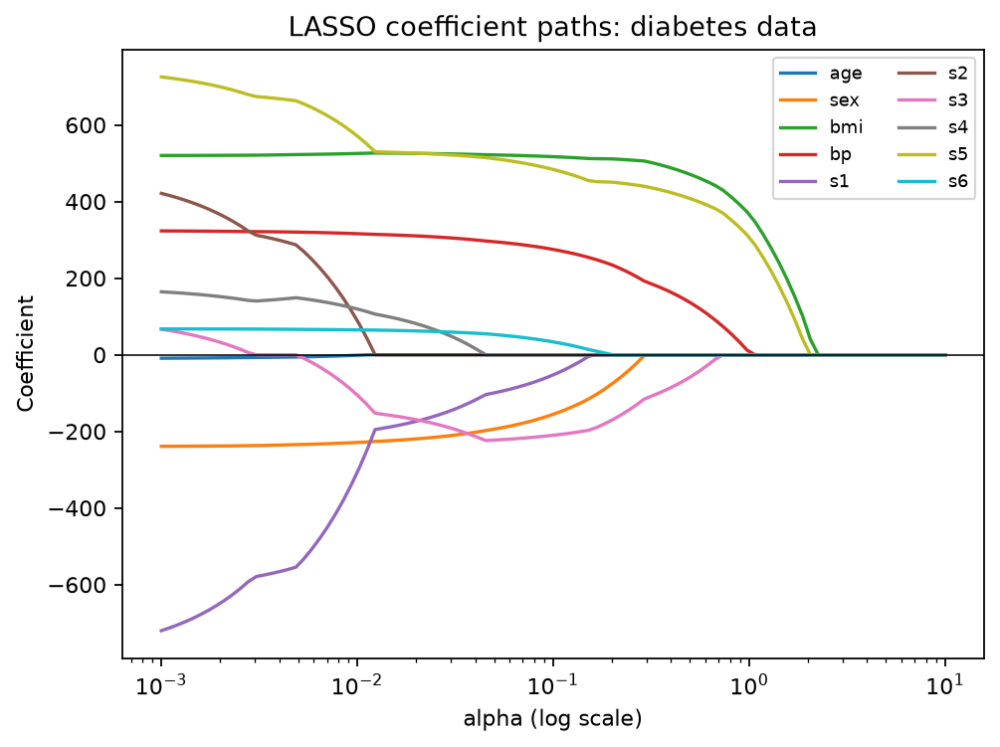

<script src="https://cdn.jsdelivr.net/npm/mathjax@3/es5/tex-chtml.js" defer></script>

# What Does It Mean When a LASSO Coefficient Becomes Zero?

In regression analysis, an important question is **which predictors should be included in a model**. For example, suppose we want to predict disease progression using a patient's age, BMI, blood pressure, and blood test results. Including every predictor is not always the best approach. Too many variables can make a model more complex and difficult to interpret.

**LASSO regression** is a method that can shrink regression coefficients and set some of them exactly to zero. But what does it actually mean when a coefficient becomes zero?

In this tutorial, we will use Python to fit LASSO models and observe how coefficients change as the penalty strength increases. We will also explain the difference between removing a variable from a model and concluding that the variable is unrelated to the outcome in the real world.

## 1. From Linear Regression to LASSO

The prediction equation for multiple linear regression is:

$$
\hat{y}_i = \beta_0 + \beta_1 x_{i1} + \cdots + \beta_p x_{ip}
$$

Here, \(\hat{y}_i\) is the predicted value for observation \(i\), \(\beta_0\) is the intercept, and \(\beta_j\) is the coefficient for predictor \(j\).

Ordinary Least Squares (OLS) minimizes the **Residual Sum of Squares (RSS)**, which is the sum of the squared differences between observed and predicted values.

LASSO adds a penalty based on the magnitudes of the coefficients. In `scikit-learn`, LASSO minimizes the following objective function:

$$
\min_{\beta_0,\ldots,\beta_p}
\left\{
\frac{1}{2n}\sum_{i=1}^{n}(y_i-\hat{y}_i)^2
+
\alpha\sum_{j=1}^{p}|\beta_j|
\right\}
$$

This equation means that **LASSO finds regression coefficients that balance minimizing prediction error and keeping coefficients small**.

## 2. Understanding the Equation

### First Term: Prediction Error

$$
\frac{1}{2n}\sum_{i=1}^{n}(y_i-\hat{y}_i)^2
$$

- \(n\): The number of observations (442 patients in our dataset).
- \(y_i\): The actual target value for patient \(i\).
- \(\hat{y}_i\): The predicted value for the same patient.
- \((y_i-\hat{y}_i)^2\): The squared prediction error.
- \(\sum_{i=1}^{n}\): The sum of squared errors across all observations.

**Why do we use \(1/(2n)\)?**

The factor \(1/n\) averages the squared errors across observations. The factor \(1/2\) simplifies differentiation by canceling the factor of 2 that appears when differentiating a squared term.

In OLS, multiplying the RSS by a positive constant does not change the optimal coefficients. However, in LASSO, **changing only the scaling of the prediction-error term without adjusting \(\alpha\) changes the relative importance of the penalty**.

### Second Term: L1 Penalty

$$
\alpha\sum_{j=1}^{p}|\beta_j|
$$

- \(p\): The number of predictors (10 in our dataset).
- \(\beta_j\): The coefficient of predictor \(j\).
- \(|\beta_j|\): The absolute value of the coefficient.
- \(\alpha \geq 0\): A parameter that controls the strength of the penalty.

For example, suppose three predictors have coefficients of \(3\), \(-2\), and \(1\). The sum of their absolute values is:

$$
|3|+|-2|+|1|=6
$$

If \(\alpha=2\), the penalty becomes \(2\times6=12\).

When \(\alpha=0\), the penalty disappears, and the objective function becomes equivalent to OLS. As \(\alpha\) increases, LASSO places more emphasis on keeping coefficients small, even if this increases the training error.

The intercept \(\beta_0\) is not penalized in this formulation.

The absolute-value penalty used by LASSO is called the **L1 penalty**. Because the absolute-value function has a sharp corner at zero, optimization can produce coefficients that are exactly zero. This is how LASSO performs feature selection.

## 3. Exploring the Diabetes Dataset with Python

The [scikit-learn diabetes dataset](https://scikit-learn.org/stable/modules/generated/sklearn.datasets.load_diabetes.html) contains 442 observations and 10 predictors, including age, BMI, and average blood pressure.

The target variable is a numerical measure of diabetes disease progression one year after baseline.

The predictors have already been centered and scaled. However, **this is different from standardization to unit variance**. Scaling is important for LASSO because the penalty depends on coefficient magnitudes.

If the required libraries are not installed, run the following command in your terminal:

```bash
python -m pip install scikit-learn pandas matplotlib tabulate
```

First, we will fit LASSO models with different penalty strengths and compare the coefficients for BMI and blood pressure, along with the number of coefficients set to zero.

```python
from sklearn.datasets import load_diabetes
from sklearn.linear_model import Lasso
import pandas as pd

# Load the dataset
X, y = load_diabetes(return_X_y=True, as_frame=True)

# Different regularization strengths
alphas = [0.01, 0.1, 1.0, 10.0]
rows = []

for alpha in alphas:
    model = Lasso(alpha=alpha, max_iter=100000)
    model.fit(X, y)

    coef = pd.Series(model.coef_, index=X.columns)

    rows.append({
        "alpha": alpha,
        "BMI coefficient": coef["bmi"],
        "BP coefficient": coef["bp"],
        "Zero coefficients": int((coef == 0).sum())
    })

results = pd.DataFrame(rows)
print(results.round(2).to_markdown(index=False))
```

### Results

The following table shows the results of fitting LASSO with four different values of \(\alpha\).

| Alpha | BMI Coefficient | BP Coefficient | Zero Coefficients |
|---:|---:|---:|---:|
| 0.01 | 525.57 | 316.17 | 0 |
| 0.1 | 517.19 | 275.08 | 3 |
| 1.0 | 367.70 | 6.30 | 7 |
| 10.0 | 0.00 | 0.00 | 10 |

At \(\alpha=0.01\), all ten predictors have nonzero coefficients. When \(\alpha=0.1\), three coefficients become zero. At \(\alpha=1.0\), seven predictors have zero coefficients, and the blood pressure coefficient is close to zero.

Finally, at \(\alpha=10.0\), all ten coefficients are zero. The model then predicts using only its intercept.

**These results demonstrate how stronger regularization can produce a simpler model.**

### Visualizing Coefficient Changes

Instead of using only four values of \(\alpha\), we can examine a wider range to visualize how the coefficients change.

```python
import numpy as np
import matplotlib.pyplot as plt

alpha_grid = np.logspace(-3, 1, 100)
paths = []

for alpha in alpha_grid:
    model = Lasso(alpha=alpha, max_iter=100000)
    model.fit(X, y)
    paths.append(model.coef_)

paths = np.array(paths)

for j, feature in enumerate(X.columns):
    plt.plot(alpha_grid, paths[:, j], label=feature)

plt.xscale("log")
plt.axhline(0, color="black", linewidth=0.7)
plt.xlabel("alpha (log scale)")
plt.ylabel("Coefficient")
plt.title("LASSO Coefficient Paths: Diabetes Data")
plt.legend(ncol=2, fontsize=8)
plt.tight_layout()

plt.savefig(
    "lasso_coefficient_paths.png",
    dpi=160,
    bbox_inches="tight"
)

plt.show()
```



*Figure 1. LASSO coefficient paths for the diabetes dataset. The horizontal axis shows the regularization strength on a logarithmic scale, and the vertical axis shows the estimated coefficients.*

As \(\alpha\) increases, more coefficients reach zero. When a coefficient is zero, its predictor no longer contributes directly to predictions made by the model fitted at that value of \(\alpha\).

However, when predictors are correlated, individual coefficients do not necessarily decrease monotonically toward zero.

## 4. Interpreting a Zero Coefficient

Consider the following simplified regression model:

$$
\hat{y}_i = 150 + 500x_{i,\mathrm{BMI}} + 0x_{i,\mathrm{BP}}
$$

In this model, changing blood pressure while holding BMI constant **does not change the predicted value**, because the coefficient for blood pressure is zero.

However, this does not prove that blood pressure is unrelated to disease progression or that blood pressure is medically unimportant.

Why?

For example, if BMI and blood pressure are correlated, they may contain overlapping information. LASSO may retain one predictor while setting the coefficient of the other to zero.

Which predictor is selected can depend on the dataset, the scaling of the predictors, and the value of \(\alpha\).

In other words, **a zero coefficient means that the predictor is not directly used in that fitted model's prediction equation. It does not mean the predictor is unrelated to the outcome in the real world**.

Additionally, LASSO coefficients describe predictive associations and should not automatically be interpreted as causal effects.

In this example, we trained the models using the entire dataset to observe how the coefficients change. Therefore, we have not evaluated their predictive performance on unseen data.

In a real prediction task, we should select \(\alpha\) using cross-validation within the training data and evaluate predictive performance on a separate test dataset.

`scikit-learn` provides [`LassoCV`](https://scikit-learn.org/stable/modules/generated/sklearn.linear_model.LassoCV.html) for selecting \(\alpha\) through cross-validation.

## 5. Conclusion and Next Steps

LASSO is a regression method that balances minimizing prediction error with an L1 penalty on coefficient magnitudes.

As \(\alpha\) increases, LASSO encourages coefficients to shrink, and some coefficients may become exactly zero, allowing the model to perform feature selection.

However, **a coefficient becoming zero does not prove that the predictor is unrelated to the outcome in the real world or that no causal relationship exists**.

To explore this further, try the following three exercises:

1. Add `alpha=0.001` and `alpha=2` to the comparison and observe how the number of zero coefficients changes.
2. Examine the coefficient-path plot and identify which predictors remain nonzero even under stronger regularization.
3. Use `LassoCV` to select \(\alpha\) through cross-validation and compare which predictors remain in the model.

By completing these exercises, you will gain a deeper understanding of how LASSO shrinks coefficients and performs feature selection.
